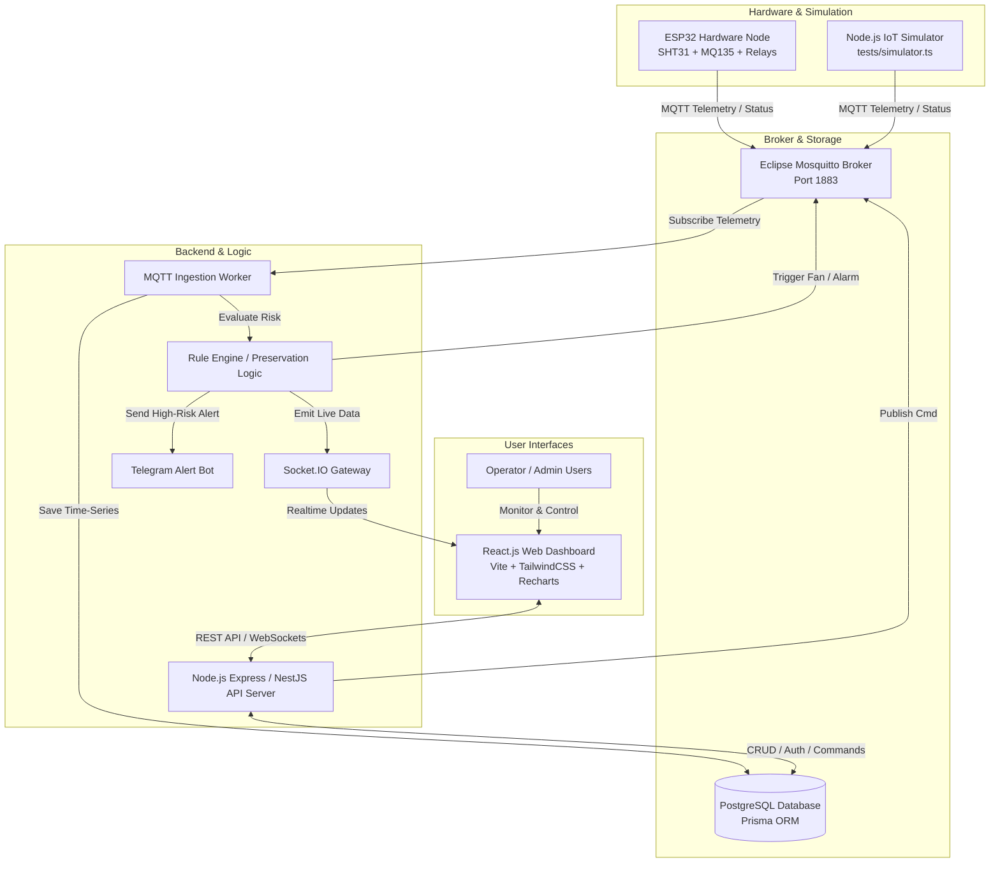
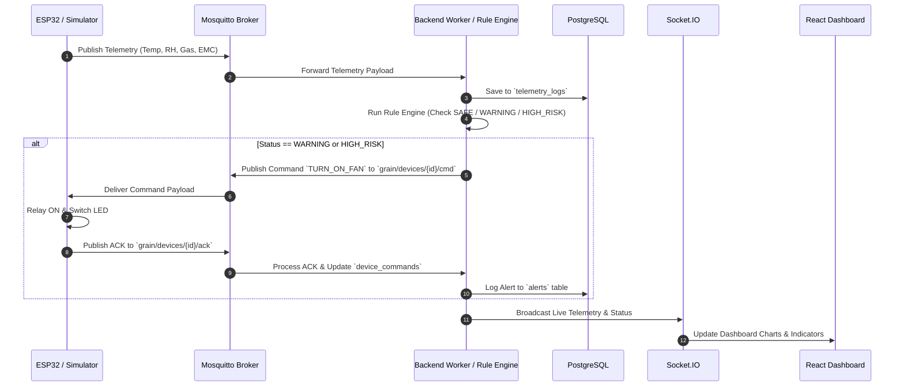
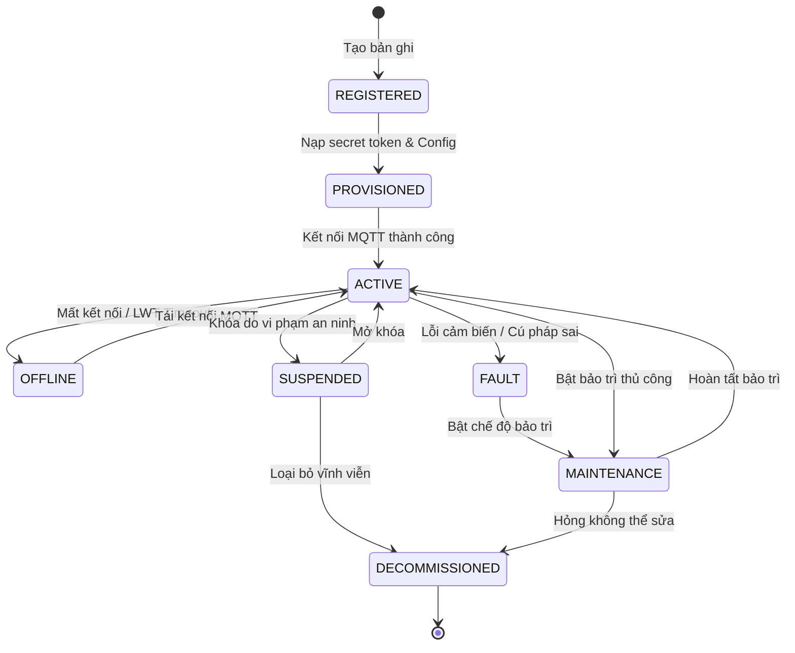

# MASTER AI CONTEXT & TECHNICAL SPECIFICATION
> **Project:** Smart Grain Storage Monitoring & Preservation System (IoT Kho Ngũ Cốc)
> **Purpose:** Tệp ngữ cảnh tổng hợp dành cho các AI Agent (Cursor, Claude, ChatGPT, Copilot) để phát triển full-stack hệ thống IoT mà không bị mất ngữ cảnh hay vi phạm quy tắc thiết kế.

---

## 1. SƠ ĐỒ HỆ THỐNG TRỰC QUAN (SYSTEM DIAGRAMS)

### 1.1 Kiến trúc tổng thể (System Architecture)



### 1.2 Luồng dữ liệu Telemetry & Control (Data & Command Flow)



---

## 2. TỔNG QUAN DỰ ÁN VÀ PHẠM VI (PROJECT OVERVIEW & SCOPE)

### 2.1 Mục tiêu Hệ thống
Hệ thống IoT giám sát vi khí hậu kho lưu trữ ngũ cốc (thóc, gạo, ngô) theo thời gian thực. Hệ thống thu thập:
- **Nhiệt độ ($T$)**: Tăng sinh nhiệt do nấm mốc hoặc sâu bệnh.
- **Độ ẩm không khí ($\%RH$)**: Quyết định tốc độ hấp thụ nước của hạt.
- **Nồng độ khí bốc mốc/lên men ($PPM$)**: Khí sinh ra từ quá trình lên men yếm khí.
- **Độ ẩm cân bằng của hạt ($EMC - Equilibrium Moisture Content$)**: Tính toán tự động theo mô hình Oswald/Halsey dựa trên $T$ và $RH$.

### 2.2 Chế độ hoạt động
1. **Chế độ Giả lập (Simulator Mode):** Sử dụng tệp `tests/simulator.ts` kết nối MQTT Broker gửi dữ liệu telemetry và nhận lệnh `cmd` / trả `ack` y hệt phần cứng thật.
2. **Chế độ Phần cứng thật (Hardware Mode):** Dùng mạch **ESP32-WROOM-32** kết nối Wi-Fi/MQTT. Việc chuyển đổi từ Simulator sang ESP32 **không làm thay đổi Backend hay Frontend**.

---

## 3. THIẾT KẾ GIAO THỨC MQTT & PAYLOAD SCHEMAS

### 3.1 Quy hoạch Topics
Cấu trúc topic chuẩn: `grain/devices/{device_id}/{channel}`

- `grain/devices/{device_id}/telemetry` (Device/Sim -> Backend | QoS 1 | Retain: false)
- `grain/devices/{device_id}/status` (Device/Sim/Broker -> Backend | QoS 1 | Retain: true)
- `grain/devices/{device_id}/cmd` (Backend -> Device/Sim | QoS 1 | Retain: false)
- `grain/devices/{device_id}/ack` (Device/Sim -> Backend | QoS 1 | Retain: false)

### 3.2 Chuẩn Payload JSON

#### A. Telemetry (`/telemetry`)
```json
{
  "msg_id": "msg_1730001234_981",
  "device_id": "DEV_SILO_01",
  "fw_version": "1.0.2",
  "timestamp": 1730001234000,
  "metrics": {
    "temperature": { "value": 24.6, "unit": "C" },
    "humidity_air": { "value": 62.5, "unit": "%RH" },
    "gas_ppm": { "value": 415.0, "unit": "ppm" },
    "estimated_emc": { "value": 12.6, "unit": "%MC" }
  },
  "actuators": {
    "fan_state": "OFF",
    "buzzer_state": "OFF",
    "control_mode": "AUTO",
    "risk_level": "SAFE"
  },
  "rssi": -64
}
```

#### B. Trạng thái & Heartbeat (`/status`)
```json
{
  "device_id": "DEV_SILO_01",
  "state": "ONLINE",
  "ip_address": "192.168.1.105",
  "fw_version": "1.0.2",
  "hw_version": "ESP32-WROOM-32-v1",
  "uptime_sec": 3620,
  "timestamp": 1730001234000
}
```
*LWT (Last Will and Testament) payload khi mất kết nối đột ngột:*
```json
{
  "device_id": "DEV_SILO_01",
  "state": "OFFLINE",
  "reason": "LWT_TIMEOUT"
}
```

#### C. Lệnh điều khiển từ xa (`/cmd`)
```json
{
  "cmd_id": "cmd_88219a",
  "device_id": "DEV_SILO_01",
  "issued_by": "user_operator_01",
  "timestamp": 1730001250000,
  "type": "ACTUATOR_CONTROL",
  "payload": {
    "target": "VENTILATION_FAN",
    "action": "TURN_ON",
    "control_mode": "MANUAL",
    "duration_sec": 600
  }
}
```

#### D. Xác nhận thực thi lệnh (`/ack`)
```json
{
  "cmd_id": "cmd_88219a",
  "device_id": "DEV_SILO_01",
  "status": "SUCCESS",
  "executed_at": 1730001250320,
  "current_actuators": {
    "fan_state": "ON",
    "buzzer_state": "OFF",
    "control_mode": "MANUAL"
  },
  "message": "Relay GPIO 26 switched HIGH"
}
```

---

## 4. SCHEMA CƠ SỞ DỮ LIỆU (POSTGRESQL / PRISMA)

```prisma
datasource db {
  provider = "postgresql"
  url      = env("DATABASE_URL")
}

generator client {
  provider = "prisma-client-js"
}

enum Role {
  ADMIN
  OPERATOR
  VIEWER
}

enum UserStatus {
  ACTIVE
  LOCKED
}

enum LifecycleState {
  REGISTERED
  PROVISIONED
  ACTIVE
  OFFLINE
  FAULT
  MAINTENANCE
  SUSPENDED
  DECOMMISSIONED
}

enum RiskLevel {
  SAFE
  WARNING
  HIGH_RISK
}

enum AlertType {
  HIGH_HUMIDITY
  HIGH_TEMP
  GAS_SPIKE
  DEVICE_OFFLINE
}

enum AlertSeverity {
  WARNING
  CRITICAL
}

enum AlertStatus {
  NEW
  ACKNOWLEDGED
  RESOLVED
}

enum CommandStatus {
  PENDING
  SUCCESS
  FAILED
  TIMEOUT
}

model User {
  id               String          @id @default(uuid())
  email            String          @unique
  password_hash    String
  full_name        String
  role             Role            @default(OPERATOR)
  status           UserStatus      @default(ACTIVE)
  telegram_chat_id String?
  created_at       DateTime        @default(now())
  managed_zones    WarehouseZone[]
  alerts_acked     Alert[]         @relation("AlertAckBy")
  commands_issued  DeviceCommand[]
  audit_logs       AuditLog[]
}

model WarehouseZone {
  id          String    @id @default(uuid())
  name        String
  grain_type  String    @default("Thóc tẻ - TCVN 8370")
  target_mc   Float     @default(14.0)
  max_rh      Float     @default(65.0)
  manager_id  String
  manager     User      @relation(fields: [manager_id], references: [id])
  devices     Device[]
  alerts      Alert[]
  created_at  DateTime  @default(now())
}

model Device {
  id                String          @id @default(uuid())
  device_code       String          @unique
  name              String
  secret_token_hash String
  zone_id           String
  zone              WarehouseZone   @relation(fields: [zone_id], references: [id])
  lifecycle_state   LifecycleState  @default(REGISTERED)
  is_online         Boolean         @default(false)
  fw_version        String          @default("1.0.0")
  hw_version        String          @default("ESP32-v1")
  config_json       Json            @default("{}")
  last_seen_at      DateTime?
  telemetry_logs    TelemetryLog[]
  alerts            Alert[]
  commands          DeviceCommand[]
  created_at        DateTime        @default(now())
}

model TelemetryLog {
  id            BigInt    @id @default(autoincrement())
  device_id     String
  device        Device    @relation(fields: [device_id], references: [id])
  msg_id        String    @unique
  temperature   Float
  humidity_air  Float
  gas_ppm       Float
  estimated_emc Float
  fan_state     Boolean   @default(false)
  risk_level    RiskLevel @default(SAFE)
  recorded_at   DateTime  @default(now())

  @@index([device_id, recorded_at])
}

model Alert {
  id            String        @id @default(uuid())
  device_id     String
  device        Device        @relation(fields: [device_id], references: [id])
  zone_id       String
  zone          WarehouseZone @relation(fields: [zone_id], references: [id])
  alert_type    AlertType
  severity      AlertSeverity
  message       String
  trigger_value Float
  status        AlertStatus   @default(NEW)
  ack_by_id     String?
  ack_by        User?         @relation("AlertAckBy", fields: [ack_by_id], references: [id])
  ack_note      String?
  created_at    DateTime      @default(now())
  resolved_at   DateTime?
}

model DeviceCommand {
  id           String        @id @default(uuid())
  cmd_id       String        @unique
  device_id    String
  device       Device        @relation(fields: [device_id], references: [id])
  issued_by_id String
  issued_by    User          @relation(fields: [issued_by_id], references: [id])
  command_type String
  payload_json Json
  status       CommandStatus @default(PENDING)
  retry_count  Int           @default(0)
  created_at   DateTime      @default(now())
  executed_at  DateTime?
}

model AuditLog {
  id           BigInt   @id @default(autoincrement())
  actor_id     String?
  actor        User?    @relation(fields: [actor_id], references: [id])
  action       String
  target_type  String
  target_id    String
  ip_address   String?
  details_json Json?
  created_at   DateTime @default(now())
}
```

---

## 5. BẢNG PHÂN QUYỀN VÀ TRẠNG THÁI THIẾT BỊ

### 5.1 Ma trận RBAC (Role-Based Access Control)

| Tính năng / Hành động | ADMIN | OPERATOR | VIEWER |
| :--- | :---: | :---: | :---: |
| Xem Dashboard / Telemetry / Biểu đồ | ✅ | ✅ | ✅ |
| Xuất Báo cáo Lịch sử (CSV/PDF) | ✅ | ✅ | ✅ |
| Điều khiển Quạt (Auto / Manual Mode) | ✅ | ✅ | ❌ (403) |
| Xác nhận / Xử lý Cảnh báo (`ACK/RESOLVE`) | ✅ | ✅ | ❌ (403) |
| Đưa thiết bị vào Bảo trì (`MAINTENANCE`) | ✅ | ✅ | ❌ (403) |
| Thêm/Đổi cấu hình Kho / Ngưỡng Cảnh báo | ✅ | ✅ | ❌ (403) |
| Khóa/Thu hồi thiết bị (`SUSPEND/DECOMMISSION`) | ✅ | ❌ | ❌ (403) |
| Quản lý Người dùng / Phân quyền User | ✅ | ❌ | ❌ (403) |
| Xem Nhật ký Hệ thống (Audit Logs) | ✅ | ❌ | ❌ (403) |

### 5.2 Vòng đời Thiết bị (Lifecycle State Machine)



---

## 6. QUY TẮC NGHIỆP VỤ RULE ENGINE (BẢO QUẢN KHO)

Dữ liệuTelemetry sau khi lưu sẽ đi qua Rule Engine với các ngưỡng:

```
                  [ Dữ liệu Telemetry Thu Thập ]
                                |
        +-----------------------+-----------------------+
        |                       |                       |
   RH <= 65%              65% < RH <= 70%            RH > 70%
 Temp <= 25.0°C         15.6°C < Temp <= 28.0°C     Temp > 28.0°C
  EMC <= 14.0%           14.0% < EMC <= 14.8%      EMC > 14.8%
  Gas < 600 ppm                 |                 Gas >= 700 ppm
        |                       |                       |
        v                       v                       v
    [ SAFE ]               [ WARNING ]            [ HIGH_RISK ]
  - LED Xanh             - LED Vàng             - LED Đỏ + Còi
  - Tắt Quạt             - Bật Quạt             - Quạt MAX
  - Bình thường          - Tạo Cảnh Báo         - Bắn Telegram + Critical Alert
```

---

## 7. SƠ ĐỒ ĐẤU NỐI PHẦN CỨNG (HARDWARE SPECS)

### 7.1 Sơ đồ chân cắm ESP32 (ASCII Pinout Diagram)

```
                       +-----------------------+
                       |     ESP32-WROOM-32    |
                       +-----------------------+
                       |                       |
         [3V3] --------| 3V3               GND |-------- [GND Common]
                       |                       |
   [I2C SHT31/OLED] ---| GPIO21 (SDA)   GPIO34 |-------- [MQ-135 A0] (ADC1)
   [I2C SHT31/OLED] ---| GPIO22 (SCL)   GPIO26 |-------- [Relay Fan IN]
                       |                       |
           [LED Green]-| GPIO14         GPIO25 |-------- [Buzzer +]
          [LED Yellow]-| GPIO27         GPIO12 |-------- [LED Red]
                       |                       |
                       +-----------------------+
```

### 7.2 Chi tiết Bảng nối dây

| Linh kiện | Chân cắm ESP32 | Điện áp | Ghi chú kỹ thuật |
| :--- | :--- | :--- | :--- |
| **SHT31 (Nhiệt/Ẩm)** | SDA: `GPIO 21`, SCL: `GPIO 22` | 3.3V | I2C Address: `0x44`. Sử dụng làm nguồn dữ liệu chính |
| **OLED Display 0.96"**| SDA: `GPIO 21`, SCL: `GPIO 22` | 3.3V | I2C Address: `0x3C`. Dùng chung bus I2C với SHT31 |
| **MQ-135 (Khí bốc mốc)**| A0: `GPIO 34` | 5.0V | Dùng ADC1 (tránh xung đột với Wi-Fi trên ADC2) |
| **Relay 5V (Điều khiển quạt)**| IN: `GPIO 26` | 5.0V | Mức cao High Trigger. Điều khiển bật/tắt quạt |
| **Còi Buzzer Chủ Động**| (+): `GPIO 25` | 3.3V/5V | Báo động khi rủi ro ở mức `HIGH_RISK` |
| **LED An Toàn (Green)** | (+): `GPIO 14` | 3.3V | Nối tiếp điện trở $220\Omega$ |
| **LED Cảnh Báo (Yellow)**| (+): `GPIO 27` | 3.3V | Nối tiếp điện trở $220\Omega$ |
| **LED Nguy Hiểm (Red)** | (+): `GPIO 12` | 3.3V | Nối tiếp điện trở $220\Omega$ |

---

## 8. KỊCH BẢN GIẢ LẬP VÀ KIỂM THỬ (SIMULATOR SCENARIOS)

Bộ giả lập `tests/simulator.ts` và **Simulator Drawer** hỗ trợ 5 kịch bản:

1. **`Normal Safe`**: $T = 22-24^\circ\text{C}$, $RH = 58-62\%$, $\text{Gas} = 400\text{ ppm}$, $EMC = 12.5\%$.
2. **`Humidity Spike`**: $RH$ tăng vọt $> 72\%$ -> Kích hoạt Rule Engine tự động bật quạt và tạo cảnh báo độ ẩm.
3. **`Fermentation Spike`**: Khí $\text{Gas} > 850\text{ ppm}$ -> Lên men sinh nhiệt, bật còi báo động khẩn cấp và gửi thông báo Telegram.
4. **`Simulate Disconnect (LWT)`**: Ngắt kết nối socket ngột ngạt -> Mosquitto Broker bắn tin nhắn LWT, hệ thống chuyển trạng thái sang `OFFLINE`.
5. **`Revoked Device Attack`**: Giả mạo tin nhắn từ thiết bị bị khóa (`SUSPENDED`) -> Backend từ chối và lưu lại `AuditLog`.

---

## 9. MẪU PROMPT CHUẨN DÀNH CHO AI AGENTS

Dưới đây là các prompt mẫu tối ưu hóa để AI hỗ trợ viết mã cho từng phần:

### 9.1 Prompt dành cho Firmware ESP32 (C++/PlatformIO)
```text
Context: Đọc tài liệu docs/AI_CONTEXT.md.
Nhiệm vụ: Viết mã nguồn C++ (PlatformIO) cho file `firmware/src/main.cpp` trên ESP32.
Yêu cầu kỹ thuật:
1. Đọc dữ liệu từ SHT31 (I2C 0x44) và MQ-135 (GPIO34).
2. Kết nối Wi-Fi & MQTT Broker (Mosquitto). Khai báo Last Will Testament (LWT) ở topic `grain/devices/{device_id}/status`.
3. Định kỳ 5 giây gửi Telemetry payload JSON chuẩn theo mục 3.2.A lên topic `grain/devices/{device_id}/telemetry`.
4. Subscribe topic `grain/devices/{device_id}/cmd`, khi nhận lệnh ACTUATOR_CONTROL thì đóng/ngắt Relay (GPIO26) và phản hồi ACK lên topic `grain/devices/{device_id}/ack`.
5. Bật/tắt đèn LED trạng thái (GPIO12, 14, 27) và Còi (GPIO25) theo ngưỡng an toàn.
```

### 9.2 Prompt dành cho Backend Node.js / Express / Prisma
```text
Context: Đọc tài liệu docs/AI_CONTEXT.md.
Nhiệm vụ: Phát triển MQTT Worker và Express REST API cho Backend trong thư mục `backend/src/`.
Yêu cầu kỹ thuật:
1. Sử dụng Prisma ORM kết nối PostgreSQL với schema ở Mục 4.
2. Viết service kết nối Mosquitto MQTT, tự động lắng nghe tất cả topic `grain/devices/+/telemetry`.
3. Khi có Telemetry tới: Lưu vào `telemetry_logs`, chạy Rule Engine (Mục 6), nếu rủi ro WARNING hoặc HIGH_RISK thì tự gửi MQTT cmd bật Quạt và emit sự kiện qua Socket.IO.
4. Viết REST API CRUD với JWT Auth & Middleware phân quyền RBAC (ADMIN, OPERATOR, VIEWER) ở Mục 5.1.
5. Xử lý timeout LWT khi thiết bị ngắt kết nối.
```

### 9.3 Prompt dành cho Frontend React Dashboard
```text
Context: Đọc tài liệu docs/AI_CONTEXT.md.
Nhiệm vụ: Viết giao diện React (Vite + TailwindCSS + Recharts + Lucide Icons) trong thư mục `frontend/src/`.
Yêu cầu kỹ thuật:
1. Kết nối Backend qua Socket.IO để cập nhật biểu đồ Nhiệt độ, Độ ẩm, Gas, EMC theo thời gian thực.
2. Thiết kế bảng danh sách thiết bị hiển thị badge trạng thái Lifecycle (10 trạng thái).
3. Tạo Simulator Control Drawer cho phép người dùng kích hoạt 5 kịch bản giả lập (Mục 8).
4. Phân quyền hiển thị theo User Role: Chặn nút bật/tắt quạt thủ công nếu role là VIEWER.
5. Thêm bảng danh sách Cảnh báo (Alerts) có nút xác nhận ACK / RESOLVE.
```

### 9.4 Prompt dành cho Simulator Script (Node.js)
```text
Context: Đọc tài liệu docs/AI_CONTEXT.md.
Nhiệm vụ: Tạo file `tests/simulator.ts` bằng Node.js & `mqtt` npm package để giả lập 3 thiết bị ESP32.
Yêu cầu kỹ thuật:
1. Gửi telemetry giả lập mỗi 3 giây với các giá trị ngẫu nhiên có độ nhiễu thực tế.
2. Hỗ trợ nhận CLI args để chuyển đổi giữa 5 kịch bản kiểm thử (Normal, Humidity Spike, Fermentation, Disconnect, Revoked Attack).
3. Lắng nghe topic `grain/devices/+/cmd` và tự động trả lại tin nhắn `/ack` phản hồi trạng thái quạt.
```


### AI: prompt
Để dựng ngay bản Web Demo kèm bộ giả lập thiết bị trong thời gian ngắn nhất, bạn hãy lưu toàn bộ tài liệu này vào tệp docs/CONTEXT.md trong thư mục dự án, sau đó sao chép lần lượt 4 câu lệnh (Prompts) dưới đây giao cho AI lập trình:
Prompt 1 – Khởi tạo Cấu trúc Dự án, Docker Compose & Cơ sở dữ liệu:"Hãy đọc toàn bộ tệp docs/CONTEXT.md để nắm rõ bối cảnh và yêu cầu đồ án Hệ thống IoT Bảo quản Kho Ngũ cốc. Hãy khởi tạo cho tôi cấu trúc thư mục chuẩn theo Mục 8.1, bao gồm: (1) Tệp deployment/docker-compose.yml chạy PostgreSQL và Eclipse Mosquitto MQTT Broker kèm tệp mosquitto.conf; (2) Tệp .env.example; (3) Tệp database/schema.prisma định nghĩa đầy đủ 7 bảng (users, warehouse_zones, devices, telemetry_logs, alerts, device_commands, audit_logs) đúng như Mục 4.1; và (4) Tệp database/seed.ts tạo sẵn 3 tài khoản (ADMIN, OPERATOR, VIEWER với mật khẩu băm Bcrypt), 2 khu vực kho thóc tẻ theo tiêu chuẩn TCVN 8370:2018 và 2 thiết bị mẫu (DEV_SILO_01 ở trạng thái ACTIVE, DEV_SILO_02 ở trạng thái PROVISIONED)."

Prompt 2 – Xây dựng Backend API, Phân quyền RBAC, MQTT Worker & Rule Engine:"Dựa trên Mục 3 và Mục 4 trong docs/CONTEXT.md, hãy viết mã nguồn hoàn chỉnh cho thư mục backend/ bằng Node.js + Express + TypeScript + Prisma + Socket.IO + MQTT.js. Hệ thống phải có: (1) Middleware xác thực JWT và kiểm tra phân quyền RBAC nghiêm ngặt ở Backend theo Ma trận Mục 4.2, tự động ghi vào bảng audit_logs mọi thao tác nhạy cảm hoặc truy cập trái phép (403 Forbidden); (2) Các REST API quản lý trọn vẹn 10 bước vòng đời thiết bị (Onboarding, cấp secret token, kích hoạt, cấu hình từ xa, bảo trì, khóa SUSPENDED và DECOMMISSIONED); (3) MQTT Worker lắng nghe grain/devices/+/telemetry, status, ack, kiểm tra chống trùng lặp qua msg_id, chặn hoàn toàn dữ liệu từ thiết bị đã bị khóa/thu hồi, tính toán chỉ số độ ẩm cân bằng estimated_emc, phân loại rủi ro SAFE/WARNING/HIGH_RISK, tự động phát lệnh bật quạt xuống topic /cmd khi vượt ngưỡng ở chế độ AUTO, xử lý timeout/retry cho lệnh điều khiển và đẩy sự kiện thời gian thực qua WebSocket lên Frontend."

Prompt 3 – Xây dựng Bộ Giả lập Thiết bị (Device Simulator) khi Chưa có Phần cứng:"Dựa trên Mục 3.2 và Mục 5.2 trong docs/CONTEXT.md, hãy viết mã nguồn cho bộ giả lập thiết bị tại tests/simulator.ts và cung cấp một API điều khiển kịch bản giả lập để phục vụ Demo trên Web khi chưa có mạch ESP32. Bộ giả lập phải kết nối thật vào Mosquitto MQTT Broker dưới định danh DEV_SILO_01, đăng ký bản tin Last Will (LWT) trên topic status, gửi bản tin telemetry định kỳ mỗi 3 giây, lắng nghe lệnh từ topic grain/devices/DEV_SILO_01/cmd (bật/tắt quạt, đổi cấu hình ngưỡng) và tự động gửi bản tin xác nhận lên grain/devices/DEV_SILO_01/ack sau 300ms. Hỗ trợ chuyển đổi tức thời giữa 5 kịch bản: (1) Bình thường an toàn, (2) Tăng độ ẩm đột ngột >72% RH gây nguy cơ nấm mốc, (3) Lên men sinh nhiệt & khí >850 ppm, (4) Ngắt mạng đột ngột để kiểm thử LWT Offline, và (5) Gửi dữ liệu bằng token của thiết bị đã bị thu hồi quyền."

Prompt 4 – Xây dựng Giao diện Web Demo & Dashboard Thời gian thực:"Dựa trên Mục 5.1 và Mục 7.3 trong docs/CONTEXT.md, hãy xây dựng ứng dụng frontend/ bằng React (Vite) + TailwindCSS + Recharts + Lucide Icons + Socket.IO Client. Giao diện cần thiết kế chuyên nghiệp, hiện đại, phục vụ trọn vẹn kịch bản Demo 10 bước: (1) Trang Login có 3 nút điền nhanh tài khoản Admin, Operator, Viewer; (2) Trang Dashboard hiển thị thẻ KPI, trạng thái ONLINE/OFFLINE, chỉ số Nhiệt độ, Độ ẩm không khí (%RH), Độ ẩm hạt ước tính (%EMC), Khí gas (ppm), nhãn rủi ro (SAFE/WARNING/HIGH RISK) và công tắc điều khiển Quạt thông gió hiển thị trạng thái chờ Pending ACK... → Active; (3) Trang Chi tiết thiết bị với biểu đồ thời gian thực, bộ lọc lịch sử, xuất CSV, form cấu hình từ xa và lịch sử lệnh; (4) Trang Quản lý vòng đời thiết bị (Onboarding, Maintenance, Suspend/Revoke, Decommission); (5) Trang Trung tâm cảnh báo (Acknowledge/Resolve); (6) Trang Audit Logs cho Admin; và (7) Một ngăn kéo góc phải màn hình ('Hardware Simulator Drawer') để bấm kích hoạt nhanh 5 kịch bản giả lập ngay trong lúc thuyết trình."
